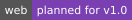
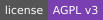

  

# saves.fm

  <!-- Badges are committed (profile/badges) so they load even when shields.io doesn't -->
  
  
  
  

saves.fm is a free, open-source history and stats app for [RetroAchievements](https://retroachievements.org) players, in the spirit of Last.fm. RA already records every unlock with a timestamp. saves.fm keeps that history over time and turns it into charts, game pages, comparisons with friends, recommendations, and a year-end Rewind.

- **Your own history, kept.** Every unlock, grouped into play sessions, with charts by week, month, year and all time.
- **Built for the community.** Free forever, open source under AGPL v3, and careful with RA's rate limits.
- **Your key stays yours.** You prove you own your RA account with a code in your profile motto. You never share an API key or password.
- **Same on every screen.** The web app comes first; the iOS and Android apps follow at full parity.

saves.fm is an independent fan project and is not affiliated with RetroAchievements.

It's in the planning stage: nothing is built yet. The full plan is in the [spec](https://github.com/saves-fm/saves/blob/main/docs/spec.md), and the [roadmap](https://github.com/saves-fm/saves#roadmap) runs from project setup (v0.1.0) to the public web launch (v1.0.0) and the mobile apps (v2.0.0). Questions and ideas are welcome in [Discussions](https://github.com/saves-fm/saves/discussions).
